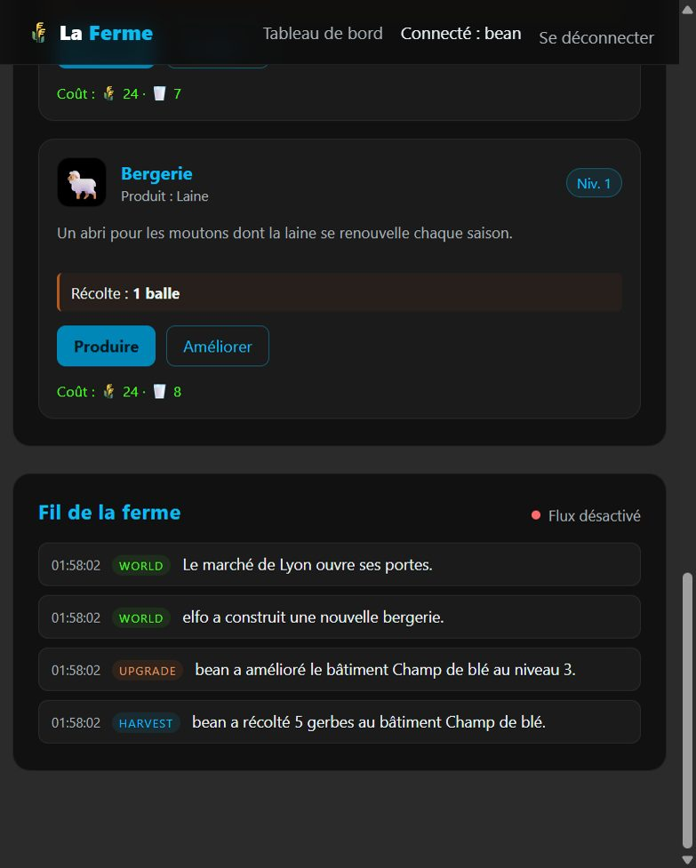
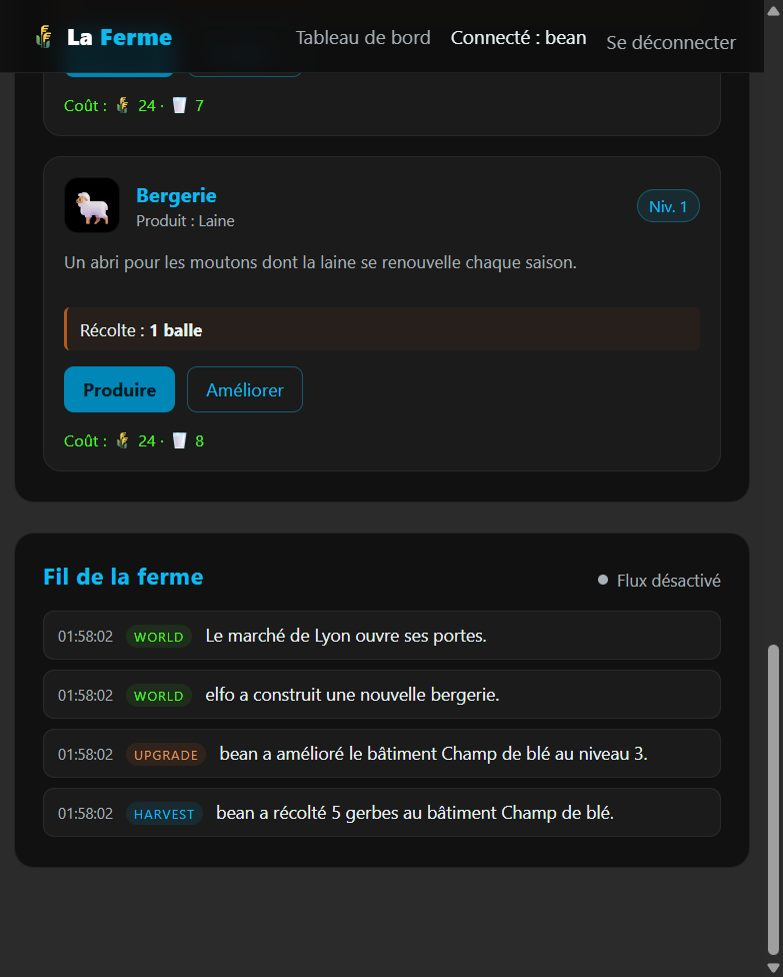

# ALW — La Ferme (PHP, Twig, API REST)


Projet du cours **Architectures et Langages du Web** (CPE Lyon) : un jeu de gestion de
ferme de type *idle game*. Le joueur récolte des produits, améliore ses bâtiments et
suit la vie de sa ferme en temps réel.

Le dépôt reprend le squelette et le framework fournis par le cours, puis déroule les
trois parties du sujet : rendu côté serveur, rendu côté client avec une API REST, et
approfondissements (CORS, PRG, météo, SSE, WebSocket).

> **Squelette, framework et énoncé** : Yannick Joly (CPE Lyon), dépôt
> [`yannick-joly/alw-projet`](https://github.com/yannick-joly/alw-projet).
> **Implémentation, tests et documentation** : [ManuelDavid69](https://github.com/ManuelDavid69).



---

## Sommaire

- [Aperçu](#aperçu)
- [Fonctionnalités](#fonctionnalités)
- [Architecture](#architecture)
- [API REST](#api-rest)
- [Les trois parties du sujet](#les-trois-parties-du-sujet)
- [Lancer le projet](#lancer-le-projet)
- [Comptes de démonstration](#comptes-de-démonstration)
- [Données du jeu](#données-du-jeu)
- [Tests et intégration continue](#tests-et-intégration-continue)
- [Choix techniques](#choix-techniques)
- [Structure du dépôt](#structure-du-dépôt)
- [Limites connues](#limites-connues)
- [Documentation](#documentation)
- [Crédits](#crédits)

---

## Aperçu

- **Authentification** par session PHP, mots de passe hachés, régénération d'identifiant
  de session et patron **Post/Redirect/Get** avec message flash.
- **Tableau de bord** en Twig : inventaire, bâtiments, coûts d'amélioration, météo.
- **Moteur visuel JavaScript** (`FermeEngine`) qui charge les règles du jeu, interroge
  l'API et met à jour le DOM sans rechargement de page.
- **API REST** pour l'inventaire, les bâtiments, les produits et les générateurs.
- **Récolte et amélioration** entièrement calculées côté serveur, dans une opération
  verrouillée (pas de triche ni de double dépense).
- **Politique CORS** restreinte à l'origine du site, avec préflight `OPTIONS` et
  méthodes autorisées par ressource.
- **Météo réelle** (Open-Meteo) qui module la production, avec cache de dix minutes.
- **Fil de la ferme** en temps réel via **Server-Sent Events**, et une variante
  **WebSocket** optionnelle avec Workerman.
- **34 vérifications de fumée** exécutées par la CI GitHub Actions.

---

## Fonctionnalités

### Côté site (port 50180)

| Fonction | Détail |
|---|---|
| Connexion | `bean` / `Beer4Life`, `elfo` / `Bumbum` |
| Session | `session_start()` centralisé, cookie de session, régénération à la connexion |
| Déconnexion | POST `/logout`, destruction de la session, redirection 303 |
| Tableau de bord | `/dashboard`, réservé aux joueurs connectés (401 sinon) |
| Inventaire | Blé, lait, œufs, laine, avec stocks et unités |
| Bâtiments | Champ de blé, vache, poulailler, bergerie |
| Actions | « Produire » et « Améliorer », boutons désactivés si le coût est hors de portée |
| Météo | Conditions de Lyon, température, vent et modificateur de production |
| Fil | Derniers événements rendus côté serveur, puis flux SSE en direct |

### Côté API (port 50181)

- Réponses JSON, codes de statut explicites (`200`, `201`, `204`, `400`, `404`, `405`, `409`, `500`).
- Validation stricte du nom de joueur (pas de traversée de chemin).
- Calcul serveur des quantités récoltées et des coûts d'amélioration.
- Verrou exclusif sur les fichiers de sauvegarde pour éviter les courses.
- CORS avec liste blanche d'origines et préflight par ressource.
- Journal d'événements tronqué aux 100 derniers, avec identifiants croissants.



---

## Architecture

```
                         Navigateur
        ┌────────────────────┴────────────────────┐
        │                                         │
  http://localhost:50180                  http://localhost:50181
  Site PHP + Twig + CSS + JS              API REST PHP (JSON)
        │                                         │
        │  FermeEngine.js / main.js               │
        └──────────── fetch / EventSource ────────┘
                                                  │
                                     ┌────────────┴────────────┐
                                     │                         │
                              src/Data (JSON)           Open-Meteo
                              sauvegardes, config,      (météo)
                              événements, cache
                                     │
                              Workerman (optionnel)
                              WebSocket :50200
```

Les deux backends sont deux applications PHP distinctes, mais elles partagent :

- le même **framework** (`Framework/`) ;
- les mêmes **classes métier** (`App/Repositories`, `App/Models`) ;
- le même **dossier de données** `src/Data/`, monté dans les deux conteneurs Docker.

Le site ne fait pas de calcul de jeu : il affiche l'état et délègue les actions à l'API.
L'API ne produit pas de HTML : elle renvoie uniquement du JSON.

---

## API REST

Les URLs sont hiérarchiques et les entités sont nommées explicitement.

| Méthode | URL | Rôle |
|---|---|---|
| `GET` | `/api/config` | Règles du jeu (produits et bâtiments) |
| `GET` | `/api/players/{player}/inventory` | Inventaire complet |
| `GET` | `/api/players/{player}/buildings` | Bâtiments et niveaux |
| `GET` | `/api/players/{player}/products/{product}` | Un produit et son stock |
| `PUT` | `/api/players/{player}/products/{product}` | Modifier un stock (`{"stock": 42}`) |
| `DELETE` | `/api/players/{player}/products/{product}` | Jeter le stock d'un produit |
| `GET` | `/api/players/{player}/generators/{generator}` | Niveau d'un générateur |
| `PUT` | `/api/players/{player}/generators/{generator}` | Modifier un niveau (`{"level": 2}`) |
| `POST` | `/api/players/{player}/buildings/{building}/harvest` | Récolter |
| `POST` | `/api/players/{player}/buildings/{building}/upgrade` | Améliorer |
| `GET` | `/api/events` | Derniers événements (`?after=`, `?limit=`) |
| `POST` | `/api/events` | Publier un événement (`{"type":"world","message":"..."}`) |
| `GET` | `/api/events/stream` | Flux SSE (`?after=`) |
| `GET` | `/api/weather` | Météo de Lyon et modificateur de production |
| `OPTIONS` | Toute URL connue | Préflight CORS |

Exemples :

```bash
curl http://localhost:50181/api/players/bean/inventory

curl -X POST http://localhost:50181/api/players/bean/buildings/champ_ble/harvest

curl -X POST http://localhost:50181/api/players/bean/buildings/champ_ble/upgrade

curl -X PUT -H 'Content-Type: application/json' \
     -d '{"stock": 25}' \
     http://localhost:50181/api/players/bean/products/ble
```

La politique CORS autorise `http://localhost:50180` et `http://127.0.0.1:50180`.
Les méthodes autorisées dépendent de la ressource : par exemple, la récolte n'accepte
que `POST` et `OPTIONS`, tandis qu'un produit accepte `GET`, `PUT`, `DELETE` et `OPTIONS`.

---

## Les trois parties du sujet

| Partie | Contenu | Points clés |
|---|---|---|
| **1 — Dynamique côté serveur** | Connexion, session, tableau de bord, point d'entrée unique, framework, Twig | `password_verify`, `$_SESSION`, routage, layout Twig, 401 |
| **2 — Dynamique côté client** | API REST, moteur JavaScript, `fetch`, BREAD, récolte et amélioration | `FermeEngine`, rendu du DOM, JSON, CORS initial |
| **3 — Approfondissement** | CORS complet, PRG, PHP client d'API, SSE, WebSocket | liste blanche, préflight par URL, météo, flux temps réel |

Le détail de chaque étape, avec les réponses aux questions du sujet, se trouve dans
[`docs/REPONSES-AUX-QUESTIONS.md`](docs/REPONSES-AUX-QUESTIONS.md) et
[`docs/ARCHITECTURE.md`](docs/ARCHITECTURE.md).

---

## Lancer le projet

### Avec Docker (recommandé)

Prérequis : Docker et Docker Compose.

```bash
docker compose up -d --build
```

Ouvrir ensuite :

- site : <http://localhost:50180/login>
- API : <http://localhost:50181/>

Arrêter les conteneurs :

```bash
docker compose down
```

Le serveur WebSocket est optionnel et isolé derrière un profil :

```bash
docker compose --profile websocket up -d
```

Il écoute sur `ws://localhost:50200`. Ouvrir alors le tableau de bord avec
`?live=ws` pour utiliser le WebSocket au lieu de SSE.

### Sans Docker (développement local)

Prérequis : PHP 8.2 avec les extensions `mbstring` et `curl`.

```bash
php -S 127.0.0.1:50180 -t src/site tools/router.php
php -S 127.0.0.1:50181 -t src/webservice tools/router.php
```

Le script `tools/router.php` reproduit la réécriture d'URL d'Apache pour le serveur
intégré de PHP.

> Le serveur intégré est mono-processus : une connexion SSE le bloque tant qu'elle
> reste ouverte. Utiliser Docker pour tester les actions et le direct en parallèle, ou
> ajouter `?live=0` à l'URL du tableau de bord pour désactiver le flux.

---

## Comptes de démonstration

| Identifiant | Mot de passe |
|---|---|
| `bean` | `Beer4Life` |
| `elfo` | `Bumbum` |

La sauvegarde d'un joueur est créée automatiquement à sa première connexion :
stocks à zéro et bâtiments au niveau 1.

---

## Données du jeu

| Fichier | Rôle |
|---|---|
| `src/Data/users.json` | Comptes et hashes de mots de passe |
| `src/Data/Config/game_config.json` | Produits, bâtiments, rendements et coûts |
| `src/Data/Saves/{login}.json` | Inventaire et niveaux du joueur (généré) |
| `src/Data/Events/feed.json` | Journal des 100 derniers événements (généré) |
| `src/Data/State/weather.json` | Cache météo de dix minutes (généré) |
| `src/site/Public/js/game_config.json` | Copie statique utilisée par le moteur JS |

La copie du fichier de configuration dans `Public/js` est volontaire : le moteur visuel
peut ainsi charger les règles sans dépendre de l'API. La CI vérifie que les deux copies
restent identiques.

Les fichiers générés (`Saves`, `Events`, `State`) sont ignorés par Git.

---

## Tests et intégration continue

```bash
bash tests/smoke.sh
```

Le script vérifie notamment :

- l'affichage de la connexion, le rejet d'un mauvais mot de passe et le PRG ;
- la création de session et l'accès protégé au tableau de bord ;
- la lecture de la configuration, de l'inventaire et des bâtiments ;
- les opérations BREAD sur les produits et les générateurs ;
- la récolte et l'amélioration, y compris le refus quand les ressources manquent ;
- les codes CORS (`204`, `405`, `404`) et les en-têtes d'origine ;
- la météo, la publication d'événements et le flux SSE.

La CI GitHub Actions exécute deux travaux :

1. **Lint** : `php -l` sur tous les fichiers PHP, `node --check` sur le JavaScript,
   vérification de la copie de `game_config.json`.
2. **Smoke tests** : démarrage des deux serveurs puis `tests/smoke.sh`.

---

## Choix techniques

### Sécurité de l'authentification

- `password_hash()` / `password_verify()` : aucun mot de passe en clair.
- `session_regenerate_id(true)` après connexion pour éviter la fixation de session.
- Le tableau de bord répond `401 Unauthorized` sans session valide.
- Les erreurs de connexion passent par un **flash** en session et une redirection 303 :
  le rechargement de la page ne rejoue pas le POST.

### Le serveur décide des quantités

Le client ne transmet jamais la quantité récoltée ni le coût d'une amélioration.
`FarmService` lit le niveau réel du bâtiment, applique le modificateur météo, vérifie
les ressources puis débite l'inventaire. Un client modifié ne peut donc pas s'offrir
des ressources.

### Concurrence sur les fichiers JSON

`SaveRepository::mutate()` ouvre le fichier en `c+`, prend un verrou exclusif
(`flock`), relit l'état, applique la modification puis réécrit. Deux clics simultanés
sur « Améliorer » ne peuvent pas dépenser deux fois le même stock.

### CORS

- Une seule origine est autorisée, au lieu de `*`.
- `Access-Control-Allow-Origin` est envoyé sur toutes les réponses.
- `Access-Control-Allow-Methods` et `Access-Control-Allow-Headers` ne sont envoyés
  qu'en réponse à un préflight `OPTIONS`.
- Les méthodes dépendent de l'URL ; une méthode non autorisée renvoie `405`.

### Météo

Le webservice interroge Open-Meteo avec un délai de 4 secondes, normalise la réponse
et la met en cache dix minutes. En cas d'échec, il réutilise le cache ou retourne une
météo neutre. Le modificateur est appliqué côté serveur lors de la récolte.

### SSE et WebSocket

- SSE : le serveur garde la connexion ouverte, envoie les nouveaux événements avec un
  `id` croissant et un `ping` toutes les dix secondes. Le client peut reprendre avec
  `?after=`.
- WebSocket : Workerman diffuse le même journal et accepte des messages texte. Il est
  fourni comme évolution optionnelle, car PHP/Apache n'est pas la pile la plus adaptée
  aux connexions longues.

---

## Structure du dépôt

```text
.
├── .github/workflows/ci.yml       Lint + smoke tests
├── conf/                          Dockerfiles et vhosts Apache
│   ├── site/
│   ├── webservice/
│   └── websocket/
├── docs/                          Architecture, réponses, captures
├── src/
│   ├── site/                      Site PHP/Twig (port 50180)
│   │   ├── App/
│   │   │   ├── Controllers/       Auth, Dashboard, Default
│   │   │   ├── Models/            User
│   │   │   ├── Repositories/      User, Save, GameConfig, Event
│   │   │   └── Templates/         Layout et vues Twig
│   │   ├── Framework/             Framework du cours
│   │   ├── Public/                CSS, JS, configuration statique
│   │   └── Twig/                  Twig 3.30 installé sans Composer
│   ├── webservice/                API REST (port 50181)
│   │   ├── App/
│   │   │   ├── Controllers/       Api, Default
│   │   │   ├── Exceptions/        ApiException
│   │   │   ├── Http/              Politique CORS
│   │   │   ├── Repositories/      GameConfig, Save, Event
│   │   │   └── Services/          FarmService, WeatherService
│   │   └── Framework/
│   └── Data/                      Données partagées (JSON)
├── tests/smoke.sh                 34 vérifications de bout en bout
├── tools/router.php               Réécriture d'URL pour `php -S`
├── ws/                            Serveur Workerman optionnel
└── docker-compose.yaml
```

---

## Limites connues

- **Authentification de l'API** : l'API fait confiance au nom de joueur présent dans
  l'URL. C'est une simplification du sujet, acceptable pour un exercice local, mais
  une application réelle signerait un jeton (JWT ou cookie HttpOnly) vérifié à chaque
  requête. Cette évolution est décrite dans `docs/ARCHITECTURE.md`.
- **Stockage JSON** : pratique pour un TP, il ne remplace pas une base de données pour
  plusieurs milliers de joueurs ou des écritures très fréquentes.
- **SSE en PHP** : chaque connexion occupe un processus Apache. Le WebSocket Workerman
  est la piste d'évolution pour un vrai temps réel à grande échelle.
- **Journal tronqué** : seuls les 100 derniers événements sont conservés.

---

## Documentation

- [`docs/ARCHITECTURE.md`](docs/ARCHITECTURE.md) — parcours du code, flux de requêtes,
  modèle de données et évolutions.
- [`docs/REPONSES-AUX-QUESTIONS.md`](docs/REPONSES-AUX-QUESTIONS.md) — réponses aux
  questions du sujet, de la question 1 à la question 30.

---

## Crédits

- **Squelette, framework, énoncé et comptes de démonstration** : Yannick Joly,
  CPE Lyon — [`yannick-joly/alw-projet`](https://github.com/yannick-joly/alw-projet).
- **Twig** : Fabien Potencier et contributeurs, licence BSD-3-Clause
  (voir `src/site/Twig/LICENSE`).
- **Météo** : [Open-Meteo](https://open-meteo.com/).
- **Implémentation des trois parties, tests, CI et documentation** :
  [ManuelDavid69](https://github.com/ManuelDavid69).
